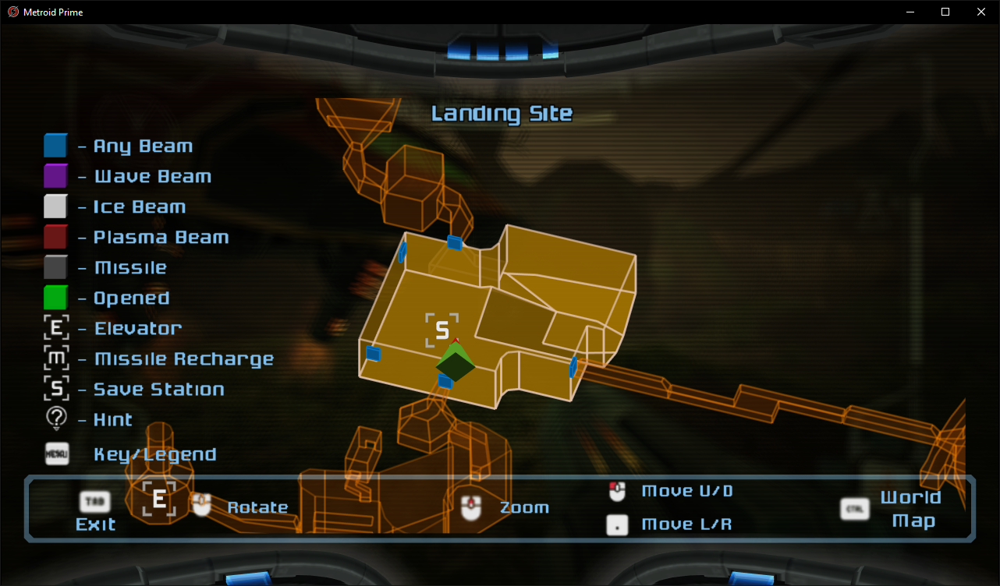
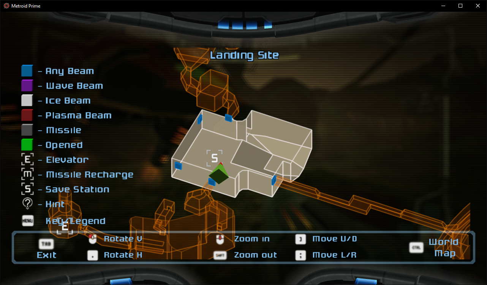
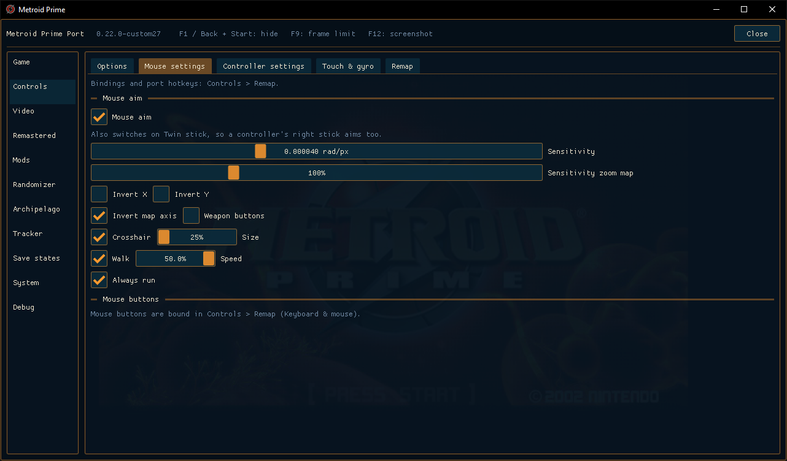
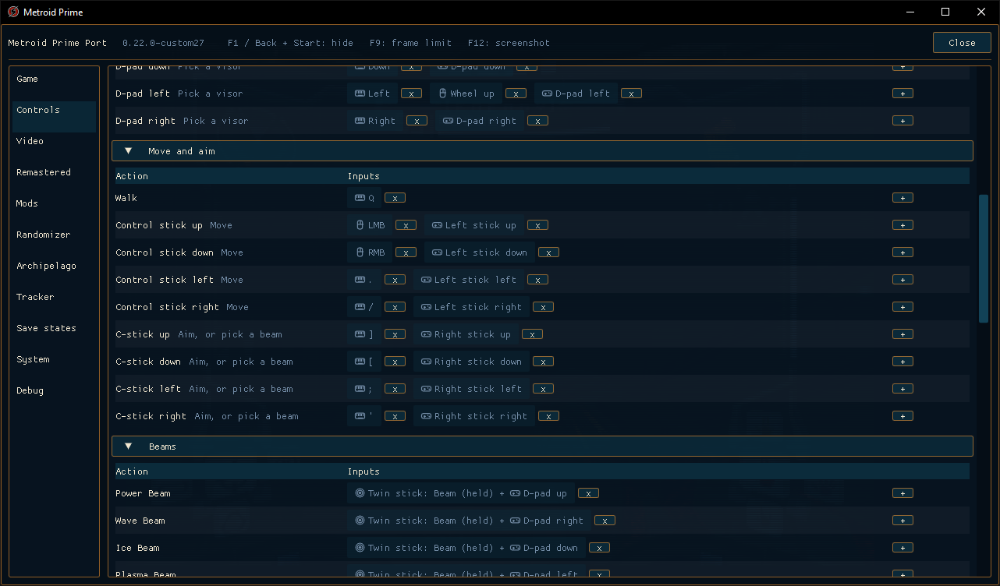
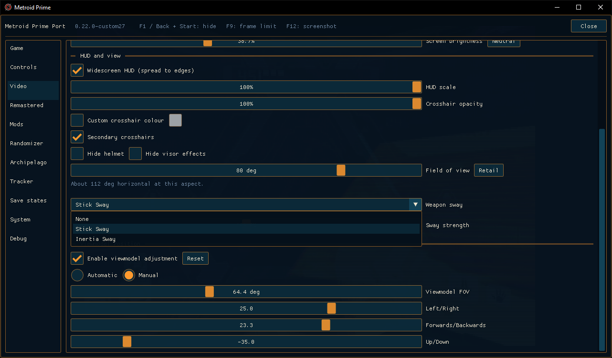
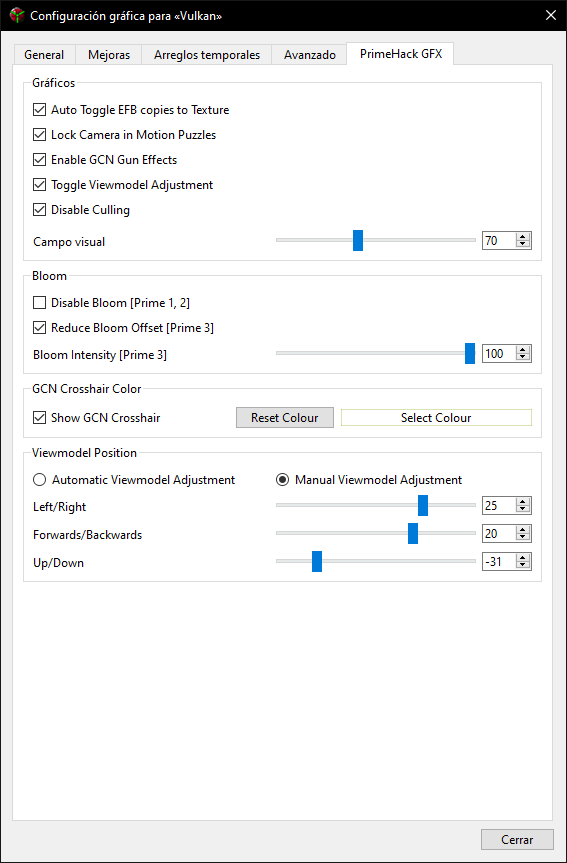
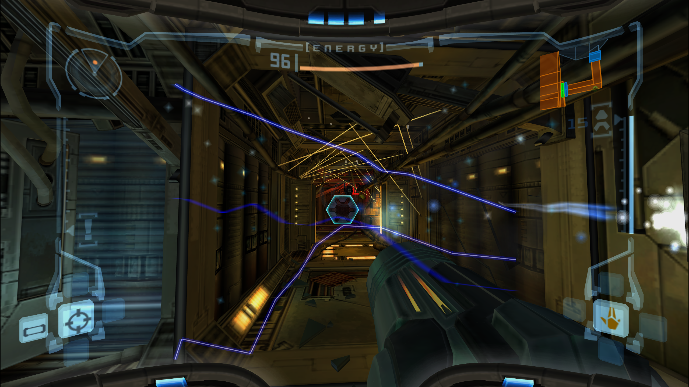
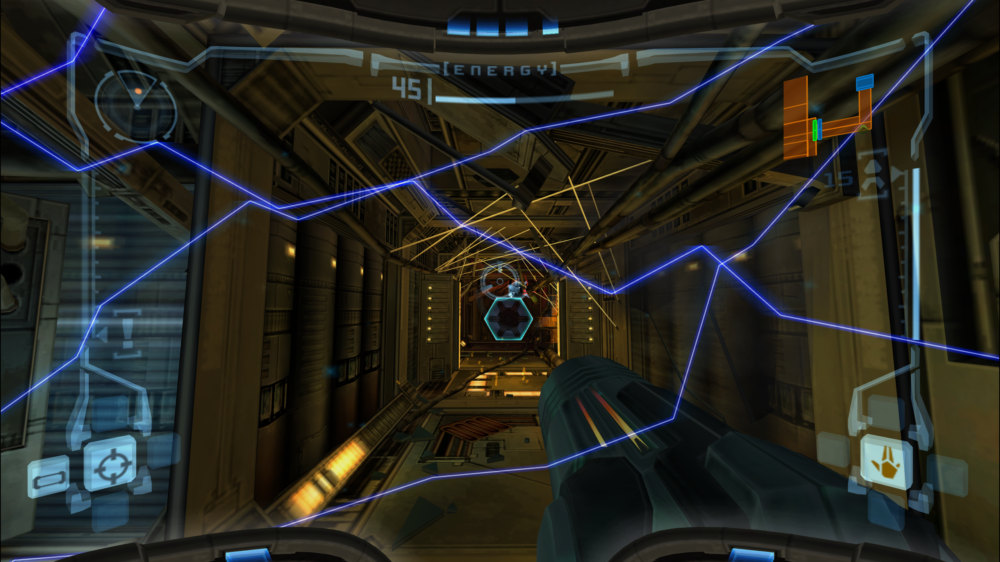
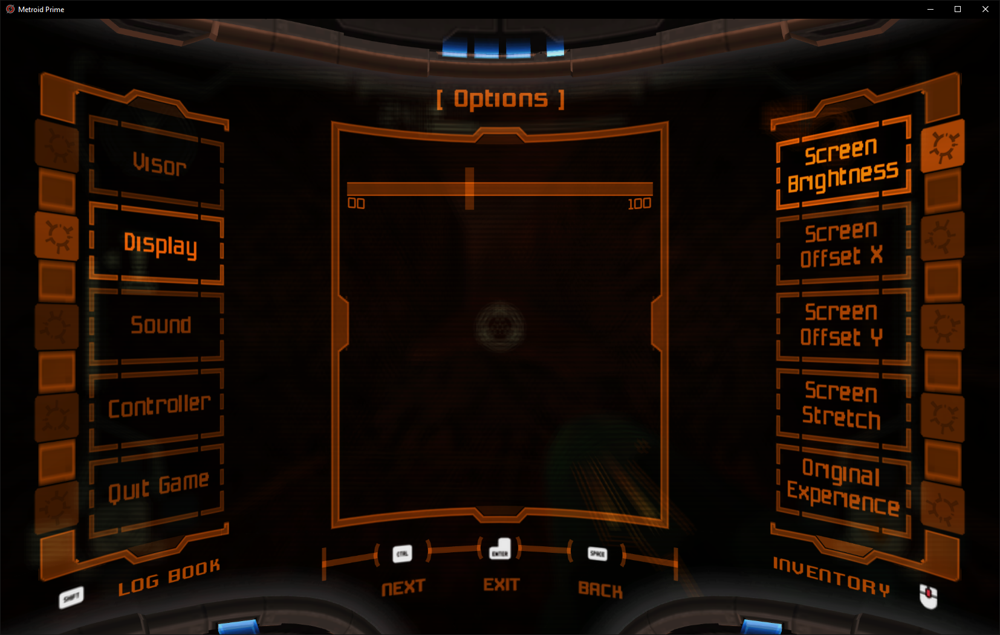

# Custom QoL screenshots

These screenshots illustrate Sol1vaN's custom27 build. They show the combined custom implementation; individual upstream PRs contain only their stated changes.

## Two map legend layouts

With **Mouse aim enabled**, the modern keyboard/mouse layout groups mouse rotation and wheel zoom, then shows **Move U/D** and **Move L/R** with the effective movement bindings. Paired direction prompts alternate smoothly, including left/right mouse-button highlights.

With **Mouse aim disabled**, the classic layout preserves the action organization of the original Nintendo GameCube controller/stick scheme, also applicable to other gamepads: **Rotate V/H**, **Zoom in/out**, and **Move U/D/L/R**. In this screenshot those original stick actions are mapped to keyboard/mouse inputs, so it shows their assigned key/button glyphs rather than a gamepad-only glyph set.

Both layouts retain the game's frame, visual style and existing prompt artwork, with supplementary glyphs where necessary (such as Menu). They adapt the instructions to the control scheme rather than replacing the map's visual design.

## Mouse settings and keyboard Walk/Run

This screen shows six-decimal high-DPI sensitivity (0.000040 rad/px), map zoom sensitivity, translation-axis inversion, walking speed and Always run. Invert map axis changes translation only, not map rotation. The displayed checkboxes and values are personal settings, not a statement of the defaults.

The Walk action is remappable alongside the movement actions:

## Weapon sway and viewmodel adjustment

The screenshot shows the earlier combined custom UI, including None, Stick Sway and Inertia Sway, strength and Viewmodel FOV. Since upstream v0.23 already implements the three arm cannon position sliders, the remaining viewmodel contribution request is **only a separate Viewmodel FOV control added to that existing section**, independent of the world-camera FOV. The additional positioning controls pictured here are historical context, not an additional implementation request.

The **Viewmodel Position / weapon viewmodel adjustment concept is referenced from [PrimeHack](https://github.com/shiiion/dolphin)**, particularly its automatic/manual adjustment and left/right, forward/backward and up/down controls. The image below is the PrimeHack reference used for this feature; it is not a screenshot of MetroidPrimePort. The reference explains the original positioning inspiration. Those position controls are now covered by upstream v0.23; the contribution request is limited to independent Viewmodel FOV.

## Aspect-correct electrical visor effects

The electrical received-damage overlay was still framed for the original 4:3 presentation. On a widescreen display, the lightning could stop short of the edges. The correction adapts the visor effect to the actual viewport aspect ratio and camera FOV, preserving the original effect artwork and animation.

**Before — original 4:3 framing on a widescreen display:**

**After — overlay adapted to the full 16:9 display:**

The screenshots capture different moments of the animated effect; they illustrate its screen coverage rather than identical particle positions.

## Restored screen brightness

The original **Screen Brightness** option now affects the final rendered image. The native menu slider uses a continuous 0–100 range instead of the original coarse integer steps, with smooth dragging and the game's characteristic click feedback. The F1 Screen brightness control and the original menu operate the same setting; 50% is neutral. This is a functional restoration as well as a smoother control.

Screenshots supplied by Sol1vaN. PrimeHack reference UI credited to the PrimeHack project; game artwork remains attributable to its original creators.
