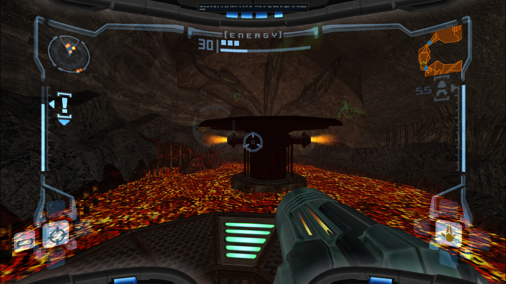
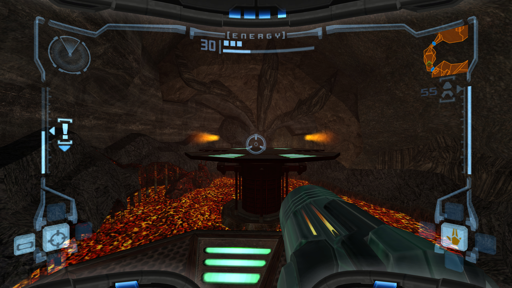
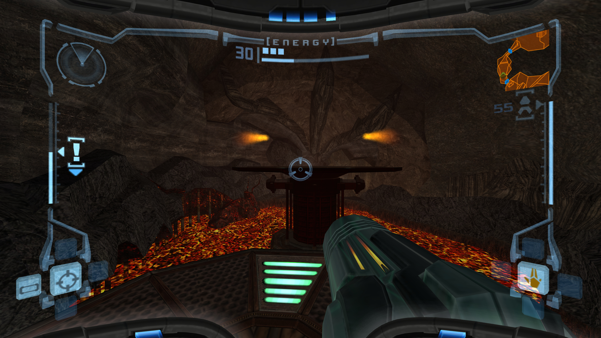

# Moving-platform and quickload effect regressions

Two independent candidate fixes based on upstream v0.28.1 (`e7c1aa5656999d7805d0480752c3cdd618e8b30e`). This branch contains only these fixes, tests and the supplied screenshots, without the other custom-build features.

1. [Platform movement compatibility commit](https://github.com/Sol1vaN/MetroidPrimePort/commit/16b20d0c70f77bb4291524efa5feff39db7d486f): preserve the retail moving-platform jump/contact contract for a full flight. A downward support probe selects the mode without moving the player. Ordinary terrain retains the official Remastered selection. This is a deliberately conservative compatibility fix rather than a claim that the retail platform primitive has been fully ported to the Remastered mover.
2. [Dependent-effect restore commit](https://github.com/Sol1vaN/MetroidPrimePort/commit/cd70c2075a2db88e45631dd70f979052d848a09d): apply saved platform poses parent-first and carry their static/dynamic slaves through the live DragSlaves path before applying the remaining saved object payloads. This repairs existing snapshots without changing their file format.

The reporter observed unreliable jumps/hovering on vertically moving platforms in official 0.28.0 and custom 0.28.0, absent in 0.27.0. Piston flame offsets occur after quickload. These are separate symptoms. Release 0.28.1 does not list either repair. Static screenshots show the location and detached flames; they cannot demonstrate a moving-platform jump in isolation.

## Supplied original screenshots

Official 0.27.0:

Official 0.28.0:

Custom 0.28.0:

## Validation limits

The new unit tests exercise selection before takeoff, unchanged selection throughout flight, landing, recovery from a falling quickload, nested slave offsets, snapshot ordering, repeated loads and cycle rejection. They do not constitute an end-to-end gameplay reproduction. The Windows UI helper failed during this investigation, so visual validation of the supplied gameplay scenario remains pending. The screenshots above are the reporter's affected/reference captures, not after-fix captures.
